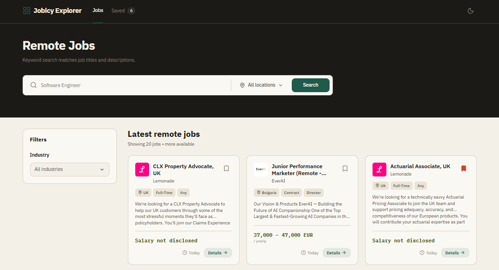

# Jobicy Explorer

**A simple way to find, filter, and save remote job listings.**

Jobicy Explorer is a front-end-only app for browsing remote job listings and saving roles for later. Listings, locations, and industries come from Jobicy's API; saved jobs and theme preference are kept in your browser. There is no account or signup flow, and the app does not ask for personal information.



---

## What You Can Do

- **Search** remote jobs by keyword
- **Filter** openings by location and industry
- **Browse** job cards with details such as location, job type, and salary when provided
- **Explore** job descriptions and open the employer's application link
- **Save** jobs and find them later on the Saved page
- **Load** more job listings as you browse
- **Switch** between light and dark themes

---

## Features

### Job Search & Browsing

- Search by keyword and choose a location
- Browse paginated listings and view job descriptions
- Open the original application link from a job's detail page
- Company logo with graceful fallback to the company initial when no image is provided

### Filters

- Filter listings by location and industry
- Search terms and selected filters are reflected in the page URL (shareable, back-button friendly)
- Clear individual filters or reset them all
- Inline error with retry when taxonomy data (locations/industries) fails to load

### Saved Jobs & Appearance

- Save and remove jobs, then revisit them on the Saved page
- Saved jobs and the light/dark theme preference persist in browser storage
- Explicit "Remove" action on saved job cards for clarity

### Accessibility

- Semantic landmarks (`<main>`, `<nav>`) and heading hierarchy
- Labeled form inputs and accessible names on icon-only buttons
- ARIA attributes on custom dropdowns (`aria-expanded`, `aria-haspopup`, `role="listbox"`)
- Escape key closes dropdowns and the mobile filter drawer
- Focus returns to the trigger after closing the mobile drawer
- Body scroll locked while the mobile drawer is open

---

## Tech Stack

| Layer | Technology |
|---|---|
| UI | React 19 |
| Language | TypeScript 6 |
| Routing | React Router 7 |
| Data fetching & caching | TanStack Query 5 |
| Client-side state | Zustand 5 |
| HTTP client | Axios 1 |
| Styling | Tailwind CSS 4 |
| Icons | Lucide React 1 |
| Build tool | Vite 8 |

**Data source:** [Jobicy API](https://jobicy.com/api/v2/remote-jobs)

---

## Architecture Highlights

- **Server state vs client state separated** — TanStack Query handles API data (caching, retries, deduplication); Zustand handles user-owned data (saved jobs, theme) with `localStorage` persistence
- **URL as filter state** — search, location, and industry live in the URL, so links are shareable and the back button works naturally
- **Feature-based structure** — components, hooks, and services are grouped by domain (`jobs`, `filters`, `layout`) rather than by type
- **Typed API boundary** — responses are typed in `src/types/jobicy.ts`; Axios requests and query hooks are fully typed
- **Consistent async states** — loading, empty, and error states are handled explicitly across all data views, including inline errors for taxonomies
- **Accessible by default** — custom dropdowns and the mobile drawer use ARIA semantics, keyboard dismissal, and focus management

---

## Project Structure


<pre>
src/                         # Application source
├── app/                     # Shared application setup
│   └── queryClient.ts
├── assets/                  # Images and starter assets
│   ├── hero.png
│   ├── react.svg
│   └── vite.svg
├── components/              # Reusable interface components
│   ├── filters/             # Job filter controls
│   │   └── FilterSidebar.tsx
│   ├── jobs/                # Job search and listing components
│   │   ├── CompanyLogo.tsx
│   │   ├── HeroSearch.tsx
│   │   └── JobCard.tsx
│   ├── layout/              # Shared page layout
│   │   └── Header.tsx
│   └── ui/
            ├── Container.tsx
            ├── EmptyState.tsx
            ├── ErrorState.tsx
            ├── InlineError.tsx
            └── JobCardSkeleton.tsx
├── config/                  # API and query settings
│   └── index.ts
├── hooks/                   # Data and URL-filter hooks
│   ├── useFilters.ts
│   ├── useJobs.ts
│   └── useTaxonomies.ts
├── pages/                   # Job list, detail, and saved pages
│   ├── JobDetailPage.tsx
│   ├── JobsListPage.tsx
│   └── SavedJobsPage.tsx
├── routes/                  # Application routes
│   └── router.tsx
├── services/                # Jobicy API client and requests
│   ├── apiClient.ts
│   └── jobsApi.ts
├── stores/                  # Persisted jobs and UI state
│   ├── uiStore.ts
│   └── useSavedJobsStore.ts
├── types/                   # Jobicy API types
│   └── jobicy.ts
├── utils/                   # Formatting and class helpers
│   ├── cn.ts
│   └── formatters.ts
├── App.css
├── App.tsx
├── index.css
└── main.tsx
</pre>

---

## Getting Started

### Prerequisites

- Node.js and npm

### Install dependencies

```bash
npm install
```

### Run the development server

```bash
npm run dev
```

### Build for production

```bash
npm run build
```

### Preview the production build

```bash
npm run preview
```